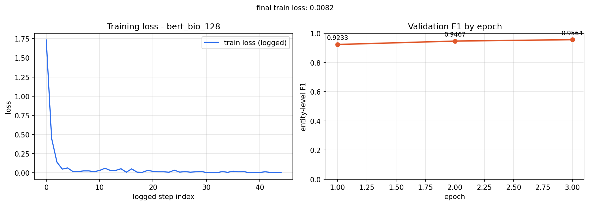

# week7 课后作业 · 换一个 BIO 数据集做抽取：人民日报 NER

> 对应课堂：week7「信息抽取」（DuEE-Fin 金融公告事件抽取，标注是 **start/end 偏移**）
>
>
> 本目录是参考答案：从过去 NER 项目里选了 **人民日报 NER**，它是**原生 BIO 标注**，
> 和课上 DuEE 的 start/end 格式形成对照。
> 重点在「原始格式 → 模型输入」的处理过程，以及可复看的训练日志。

---

## 0. 先回答课上那个问题：序列标注数据集都长这样吗？

**不是。** 至少有三族常见格式，课上的 DuEE 只是其中一种：

| 格式族 | 典型数据 | 一条标注长什么样 | 特点 |
|---|---|---|---|
| **start/end 偏移** | 课上 DuEE-Fin 事件、cluener2020 的 span 字典 | `{"text": "...", "event": {"trigger": {"start": 38, "end": 40}, "args": [...]}}` | 一个实体/论元 = 一对整数；**能表达重叠/嵌套**；但需要自己维护「偏移对应哪段原文」 |
| **逐 token BIO / BIOES** | 人民日报 NER、MSRA、CoNLL-2003、Weibo NER | `tokens: [海,钓,...,厦,门,...]` + `ner_tags: [O,O,...,B-LOC,I-LOC,...]` | 每个字/词背一个标签；**没有显式偏移**，start/end 要由标签推；**一个位置只能一个标签** |
| **结构化 JSON / JSONL** | 事件记录、关系三元组、指令数据 | `{"events": [{"type": "...", "arguments": {...}}]}` | 最灵活；适合多事件、多角色；但和「逐 token 分类」之间要写更多转换代码 |

本作业选的是第二族。它和课上格式的**核心差异**：

1. **BIO 没有 offset**。课上 `trigger` 直接给 `start=38, end=40`；BIO 只给每个字一个标签，
   实体的起止是**数出来的**。所以 `bio_to_spans()` / `spans_to_bio()` 是必写的一对函数。
2. **BIO 是单标签的**。一个 token 只能有一个标签，所以**重叠/嵌套实体转成 BIO 必然丢信息**。
   课上的事件抽取里，触发词和论元、多个论元之间都可能重叠，所以它保留 start/end 结构，
   或者用「13 类触发词 + 61 个角色 = 149 个 joint 标签」把角色也编进标签（week7 的 `bert/` 就是后者）。
   149 标签仍然是「一个 token 一个标签」，所以它同样表达不了重叠——只是把「角色」塞进了标签名。
3. **BIO 的标签数通常少**。本数据集 7 个标签（O + 3 类 × B/I）；课上 joint 是 149 个。
   标签数直接决定分类头大小、类别不均衡程度和「非法转移」的概率。

> 一句话：**BIO 是最常见的 NER 格式，但不是序列标注的唯一格式；事件抽取因为「多类型 + 多角色 + 可能重叠」，
> 更常用 start/end 或结构化 JSON。** 换数据集时，第一件事就是看清楚它属于哪一族。

---

## 1. 作业要求与参考答案的范围

学生要交的东西（建议按这个清单自查）：

- [ ] 选一个**不是课上 DuEE 格式**的数据集（BIO / BIOES / span 字典 / CoNLL 均可），说明来源；
- [ ] 写清楚**原始格式 → 模型输入**的转换步骤：谁变成 `input_ids`、谁变成 `labels`、偏移/截断怎么处理；
- [ ] 用 BERT 训一版，报 **validation / test 的 entity-level P/R/F1**（不是 token accuracy）；
- [ ] 交**完整训练日志**：每个 epoch 的 loss/验证指标/耗时，最好有逐步 loss；
- [ ] 回答：这个数据集和课上 DuEE 差在哪？转换时丢了什么？如果让你换回事件抽取，会怎么改？

本参考答案的范围：

| 项 | 做什么 | 不做什么 |
|---|---|---|
| 数据集 | 人民日报 NER（BIO，3 类，20,864 / 2,318 / 4,636） | 不重新标数据、不爬新数据 |
| 模型 | `bert-base-chinese` + 线性分类头（7 分类） | 不上 CRF、不上 LLM（CRF 放「进阶」） |
| 指标 | entity-level seqeval P/R/F1 + 逐类型 + 非法 BIO + 截断 + 错误分类 | 不追 SOTA、不调参刷点 |
| 产物 | 训练三件套 + 评估 JSON + 逐条预测 + loss 曲线 | 不附 400MB 权重（复现请重训） |

---

## 2. 数据集：人民日报 NER（BIO）

### 2.1 规模与格式

| 维度 | 值 |
|---|---|
| 训练 / 验证 / 测试 | **20,864 / 2,318 / 4,636** 句 |
| 实体类型 | **3 类**：PER 人名 / ORG 机构 / LOC 地名 |
| 标签数 | **7**：`O`、`B-PER`、`I-PER`、`B-ORG`、`I-ORG`、`B-LOC`、`I-LOC` |
| 标注单元 | 单字（`tokens` 是字符列表，不是原始句子） |
| 句长 | 字级 p50=40，p95=97，p99=144，max=574 |
| 标签密度 | `O` 占 **88.76%**（train），实体很稀 |
| 金标非法 BIO | **0**（数据本身是干净的，非法只可能来自模型预测） |
| train 与 val/test 重复 | **0**（已逐句检查，无泄漏） |

单条样本：

```json
{
  "tokens": ["海","钓","比","赛","地","点","在","厦","门","与","金","门","之","间","的","海","域","。"],
  "ner_tags": ["O","O","O","O","O","O","O","B-LOC","I-LOC","O","B-LOC","I-LOC","O","O","O","O","O","O"]
}
```

注意：**没有 `text` 字段，也没有 `start` / `end`**。原文是 `"".join(tokens)`，
实体偏移要由 `ner_tags` 推出来——这是和课上 DuEE 最直观的区别。

> 原始发布其实是 **CoNLL 格式**（每行 `字符 BIO标签`，空行分句），旧项目的
> `download_data.py` 已用 `_parse_conll()` 解析成上面的 JSON。也就是说，从原始文件到
> 模型输入其实有**两层**格式转换：CoNLL 文本 → JSON(tokens+tags) → BERT 的 input_ids/labels。
> 学生自己下原始数据时，第一层也要自己写；本目录为了聚焦第二层，直接给了 JSON 版。

### 2.2 为什么选它

- **原生 BIO**：不是把 span 硬转成 BIO 的人工数据，能真实展示「BIO 数据集怎么处理」；
- **和课上格式不同**：课上 DuEE 是 start/end 事件，这里是逐 token 标签，对照最强；
- **规模适中**：2 万训练句，单卡 4060 约 5 分钟/epoch，学生能自己跑完；
- **类型少、边界清晰**：3 类粗粒度，BERT 能到 0.95 左右，学生容易看到「跑通了」的正反馈；
- **过去项目已有**：来自 `bert_ner` 的 `data/peoples_daily/`，不重新下载、不重新标注。

> 数据仅限课程学习，请勿商用或再次分发。字段说明见 [`data/README.md`](data/README.md)。

---

## 3. 处理流程（本作业的核心）

整条链路：

```
JSON(tokens + ner_tags)
   │  ① 读入，校验长度/标签
   ▼
字符级 BIO 标签
   │  ② tokenizer(is_split_into_words=True) → word_ids
   ▼
子词级 input_ids + labels（非首子词/特殊 token = -100）
   │  ③ Dataset / DataLoader（padding 到 max_length）
   ▼
BERT + Linear → 每个 token 7 分类
   │  ④ argmax → 子词标签 → 映射回字符 → BIO
   ▼
span 列表 → seqeval entity-level P/R/F1
```

### 3.1 读数据：先校验，再转换

`src/dataset.py` 的 `NerDataset.__init__` 会先做两件事：

- `len(tokens) == len(ner_tags)`，不等直接报错（脏数据最常见的形态）；
- 每个标签都在 `label_names.json` 里，出现未知标签直接报错（避免 id 映射错位后静默掉点）。

**为什么不边训边校验**：训练到一半才发现第 18,000 条标签写错，前面的 GPU 时间全浪费；
启动时一次 O(N) 检查只要几秒。

### 3.2 BIO → start/end 实体（评估、展示都要用）

`src/bio_labels.py::bio_to_spans()`：

```python
# 从左到右扫标签：
#   O        → 关掉当前实体
#   B-X      → 关掉上一个，开一个新实体（类型 X）
#   I-X      → 如果当前实体也是 X，继续；否则按非法序列修复成新实体
# 最后把 [start, end) 切片出来，text = "".join(tokens[start:end])
```

三个关键点：

1. **偏移是左闭右开 `[start, end)`**，和 Python 切片一致。`"厦门"` 是 `start=7, end=9`，
   不是 `end=8`。如果别的数据集给你的是**闭区间 end**（含最后一个字），必须自己 `+1`。
2. **非法序列要单独统计，不要偷偷修完就算**。`check_bio()` 会数：
   - `I-X` 开头；
   - `O → I-X`；
   - `B-X → I-Y`（类型中途变了）。
   线性头逐 token 独立预测，出现这些很正常；修成 span 只是让评估能继续，不代表预测是对的。
3. **回环校验**：`bio → spans → bio` 必须和原标签完全一致。`explore_data.py` 对第一条样本做了这个断言，
   偏移差一位会立刻暴露。

### 3.3 start/end → BIO（换数据集时最常写）

很多公开数据集给的是 `{"text": ..., "entities": [{"start":..., "end":..., "type":...}]}`，
要转成 BIO 才能喂给逐 token 分类。`spans_to_bio()` 的做法：

```python
tags = ["O"] * len(tokens)
for span in spans:
    tags[start] = f"B-{type}"
    for i in range(start + 1, end):
        tags[i] = f"I-{type}"
```

**但这一步不是无损的**：如果两个 span 在同一个位置重叠，后写的会被丢掉。
函数会返回 `conflicts` 列表，把「谁被谁覆盖」记下来。`explore_data.py` 用
「北京大学 = ORG，北京 = LOC」演示了这一点：转成 BIO 只剩 `B-ORG I-ORG I-ORG I-ORG`，
LOC 的信息丢了。

> 这正是「BIO 能不能表达事件抽取」的答案：**单标签序列表达不了重叠**。
> 事件抽取里触发词和论元、论元和论元都可能重叠，所以课上保留 start/end 结构，
> 或者把角色编进 joint 标签（149 类）——后者仍然是单标签，只是标签名更细。

### 3.4 子词对齐：只有第一个子词背标签

`src/dataset.py::NerDataset.__getitem__`：

```python
enc = tokenizer(chars, is_split_into_words=True, max_length=128,
                truncation=True, padding="max_length", return_tensors="pt")
word_ids = enc.word_ids(0)   # [None, 0, 1, ..., None]

for wid in word_ids:
    if wid is None:                 # [CLS]/[SEP]/[PAD]
        labels.append(-100)
    elif wid != prev_word_id:       # 该字符的第一个子词
        labels.append(label2id[tags[wid]])
    else:                           # 同一字符的后续子词
        labels.append(-100)
```

为什么必须这样：

- **一个字符被切成多个子词时**，如果每个子词都背标签，一个实体在 loss 里会被算好几遍，
  实体越长的样本权重越大，训练会偏；
- **[CLS]/[SEP]/[PAD] 不能背标签**，否则模型会去学「[CLS] 应该是什么实体」；
- 本数据集实测**一个字符都没有被切成多个子词**（1,308,247 个字符，0 次多子词），
  所以「字符级 = token 级」；但代码不能假设这一点，换英文/数字多的数据集就会遇到。

### 3.5 截断：max_length=128 会掉 1.7% 的句子

| split | 截断句数 | 占比 | 完全掉尾实体 | 跨边界实体 |
|---|---|---|---|---|
| train | 357 / 20,864 | 1.71% | 784 | 17 |
| validation | 41 / 2,318 | 1.77% | 162 | 2 |
| test | 79 / 4,636 | 1.70% | 257 | 6 |

`max_length=128` 是「p95=97 字 + 特殊 token」的折中：扣掉 `[CLS]/[SEP]` 后能放 126 个内容 token，
实测约 **98.3%** 的句子完整，只有 **1.7%** 被截。被截掉的尾巴实体在评估里就是**漏检**，
所以评估要单独报 `truncation`，不能假装没发生。
想更干净可以上 `max_length=256`（截断率接近 0），代价是显存/时间上升——这是进阶项，不是必做。

### 3.6 评估：entity-level，不是 token accuracy

本数据集 88.76% 的 token 是 `O`。一个「全预测 O」的模型 token accuracy 约 **89%**，
但它一个实体都没识别出来。所以评估用 `seqeval` 的 **entity-level** 指标：

- 一个实体必须 **类型 + 起止** 完全匹配才算 TP；
- P/R/F1 按实体算，不按 token 算；
- 同时报逐类型 F1（PER/ORG/LOC），看哪类最难。

---

## 4. 训练配置

| 项 | 值 | 为什么 |
|---|---|---|
| 硬件 | RTX 4060 Laptop（8GB），Windows 11 | 课堂/学生常见配置 |
| 基座 | `bert-base-chinese`（101.7M 可训练参数） | 和课上 BERT 基线同源，只换数据 |
| 任务头 | 线性分类（7 类） | 最直接对应 BIO 逐 token 分类；CRF 放进阶 |
| epochs | 3 | 2 万句、5 分钟/epoch，3 轮足够收敛 |
| batch size | 32 | 8GB 显存下稳定，实测峰值约 3.7GB |
| max_length | 128 | p95=97 字，截断率 1.7% |
| lr（BERT） | 2e-5 | BERT 微调常用区间 |
| lr（分类头） | 1e-4（5×） | 随机初始化的头需要更大步长 |
| warmup | 10% | 防止训练初期大梯度破坏预训练权重 |
| weight decay | 0.01 | 常规正则 |
| seed | 42 | 固定随机性（同 seed 不保证逐位复现） |
| 日志频率 | 每 50 步 | steps.jsonl 约 14 行/轮（652 步/轮），够画曲线又不臃肿 |

> 为什么不用 CRF：本作业的重点是**数据格式处理**。线性头把「每个 token 独立 7 分类」
> 这条最短链路跑通，学生能清楚看到 BIO 标签怎么变成 loss；CRF 是在此之上加转移约束，
> 属于「进阶」，见 §11。课上 week7 的 BERT+CRF 是事件抽取主线，两者不冲突。

---

## 5. 结果

### 5.1 主指标（entity-level，seqeval）

> 口径：`validation` 2,318 句 / `test` 4,636 句；一个实体必须**类型 + 起止**完全匹配才算 TP。
> 这里报的 support 是「截断后仍完整进入模型」的实体数（见 §5.4 的截断说明）。

| split | Precision | Recall | **F1** | 参与评估的实体数 |
|---|---|---|---|---|
| validation | 0.9538 | 0.9590 | **0.9564** | 3,657 |
| test | 0.9333 | 0.9479 | **0.9405** | 7,450 |

### 5.2 逐类型指标

| 类型 | val P / R / F1 | test P / R / F1 | val support | test support |
|---|---|---|---|---|
| **LOC** 地名 | 0.9590 / 0.9611 / **0.9600** | 0.9415 / 0.9524 / **0.9469** | 1,799 | 3,464 |
| **ORG** 机构 | 0.9164 / 0.9324 / **0.9243** | 0.8861 / 0.9155 / **0.9005** | 976 | 2,166 |
| **PER** 人名 | 0.9852 / 0.9841 / **0.9847** | 0.9753 / 0.9780 / **0.9767** | 882 | 1,820 |

**ORG 是最难的一类**（test F1 0.9005，比 PER 低 7.6 个点）。原因从 bad case 里看得很清楚：
机构名的边界经常和地名/修饰语粘在一起（"美国前商务部"、"国家大剧院"），
而 PER 的边界模式最固定（姓氏 + 名字），所以最好。

### 5.3 逐 epoch 训练过程

| epoch | train_loss | val_loss | val P | val R | val F1 | 非法序列 | 用时 |
|---|---|---|---|---|---|---|---|
| 1 | 0.1436 | 0.0206 | 0.9118 | 0.9352 | 0.9233 | 104 | 297s |
| 2 | 0.0172 | 0.0168 | 0.9416 | 0.9519 | 0.9467 | 41 | 295s |
| 3 | 0.0082 | 0.0167 | 0.9538 | 0.9590 | **0.9564** | 39 | 297s |

- 总耗时 **893.8s ≈ 14.9 min**；峰值显存 **3,728 MB**；可训练参数 **101,682,439（101.7M）**。
- **第 3 轮才到最优**：第 2 轮 0.9467、第 3 轮 0.9564，还在涨，说明 3 epoch 是下限而不是上限；
  但第 3 轮 train_loss 已到 0.0082，再训下去收益会变小、过拟合风险变大。
- **非法 BIO 随训练下降但没归零**：104 → 41 → 39 条（val）。
  线性头逐 token 独立预测，本来就没有标签间约束；这正好说明「要硬约束得上 CRF 或解码期 mask」。



### 5.4 截断、非法序列、句子级 exact match

| 指标 | validation | test |
|---|---|---|
| 截断句数 / 占比 | 41 / 2,318（1.77%） | 79 / 4,636（1.70%） |
| 完全掉尾的实体 | 162 | 257 |
| 跨截断边界的实体 | 2 | 6 |
| 非法 BIO 序列 / 占比 | 39（1.68%） | 107（2.31%） |
| 非法转移次数 | 45 | 132 |
| 句子级 exact match（仅未截断句） | 2,121 / 2,277 = **93.15%** | 4,174 / 4,557 = **91.60%** |

**一个很好用的自洽检查**：原始 val 实体 3,819 个，截断掉 162 个，剩 3,819 − 162 = **3,657**，
正好等于 §5.1 的 support；test 7,707 − 257 = **7,450**，也正好对上。
如果这两个数对不上，说明「截断统计」或「标签对齐」有一处写错了。

### 5.5 错误分类（仅未截断句）

| 错误类型 | 含义 | validation | test |
|---|---|---|---|
| `miss` | 金标有、预测完全没有 | 61 | 147 |
| `spurious` | 预测有、金标没有 | 81 | 253 |
| `type` | 边界完全对、类型错 | 19 | 55 |
| `boundary` | 类型对、边界错 | 62 | 165 |
| **合计** | | **223** | **620** |

test 上 **spurious（253）比 miss（147）多**，说明模型在测试集上更「敢标」，
但多标出来的实体不少是「金标没标、模型认为该标」的边界案例（如 "幸福工程" 金标为空、
模型把它标成 ORG）。`boundary`（165）是第二大错误，集中在 ORG：机构名的后缀
（"队/部/院/公司"）经常被切掉或多带一个字。

### 5.6 三个典型 bad case（都能直接拿来讲格式问题）

**① 嵌套实体：BIO 一个位置只能一个标签**

```
原文：...在中南海会见了美国前商务部长芭芭拉·弗兰克林。
金标：ORG [28,34) "美国前商务部"      ← 整个机构
预测：LOC [28,30) "美国" + ORG [31,34) "商务部"  ← 拆成两个
```

"美国" 是 "美国前商务部" 里面的地名，两者**重叠**。BIO 序列在一个位置只能写一个标签，
模型没法同时输出「这里是 ORG 的一部分，也是 LOC」；它只能二选一，于是把 "美国" 切出去当地名。
这不是模型"笨"，而是**格式表达力**的限制——想同时保留嵌套实体，就得用 start/end 的多标签方案。

**② 类型混淆：ORG vs LOC**

```
"金大中"     金标 PER，预测 ORG
"国家大剧院" 金标 LOC，预测 ORG
```

人名/地名/机构名在新闻里经常互相修饰（"国家大剧院"既像机构又像地点），
3 类粗粒度体系下这类边界本身就模糊；这也是 ORG F1 最低的原因之一。

**③ 标注噪声：别把 100% 当目标**

```
"古阳关" 金标 PER，预测 LOC
```

"古阳关"是地名（LOC），金标却标成了 PER——这是公开数据集的**标注不一致**。
在人民日报 NER 上，test F1 0.94 左右已经接近这个标签体系的上限；
再往上刷，很可能是在拟合噪声。写报告时应该把这类样本单独列出来，而不是硬调参。

### 5.7 和上一期同数据的结果对照（sanity check）

上一期 week7 作业（已归档到 `课后作业/backup/week7/peoples_daily_exp/`）在同一份数据上
用同一套 BERT+Linear 配置跑过：val 0.9547 / test 0.9415。

本次（固定 seed=42）：val **0.9564**（+0.17pp）/ test **0.9405**（−0.10pp）。
上一期没有固定 seed，0.1~0.2pp 的差异属于正常波动。**结论：流程复现一致，数字可用。**
（上一期还跑了 BERT+CRF：val 0.9581 / test 0.9458；本次作业只要求一版，CRF 放 §11 进阶。）

---

## 6. 完整日志：三个文件怎么看

训练脚本（`src/train.py`）和课件 week7 用同一套「三件套」，都在 `outputs/logs/`：

| 文件 | 内容 | 什么时候看 |
|---|---|---|
| `bert_bio_128_train.json` | 结构化总结：`args`、`env`、每个 epoch 的 `train_loss` / `val` / `elapsed_s`、总耗时、参数量、峰值显存、`best_epoch` | 想知道「这组结果到底用什么超参跑的」「哪轮最好」 |
| `bert_bio_128_steps.jsonl` | 每 50 步一行：`epoch`、`step`、`loss`、`lr`、`elapsed_s` | 画 loss 曲线、看有没有 NaN/突刺、看学习率调度 |
| `bert_bio_128_console.log` | 本次运行的完整 stdout（含每步/每轮打印、最终汇总） | 出问题时第一现场；和 `train.json` 对得上 |

评估脚本额外产出：

| 文件 | 内容 |
|---|---|
| `bert_bio_128_eval.json` | validation + test 的 P/R/F1、逐类型指标、非法 BIO、截断统计、句子级 exact match、错误分类 |
| `bert_bio_128_eval_console.log` | 评估过程的完整 stdout（含 bad case 打印） |
| `outputs/predictions/validation_predictions.jsonl` | 验证集逐条预测（文本 + 金标 span + 预测 span） |
| `outputs/predictions/test_predictions.jsonl` | 测试集逐条预测 |

**为什么训练和评估的 console 日志要分开**：`TrainLogger` 和 `EvalLogger` 都会 tee stdout，
如果评估复用同一个文件名，会把训练日志**整个覆盖掉**，学生事后就只剩评估输出。
所以 `EvalLogger` 单独用 `console_name="<run>_eval"`。

自己读日志的常用命令：

```powershell
# 每个 epoch 的 val F1
python -c "import json;d=json.load(open('outputs/logs/bert_bio_128_train.json',encoding='utf-8'));[print(e['epoch'],e['train_loss'],e['val']['f1'],e['elapsed_s']) for e in d['epochs']]"

# 逐步 loss（每 50 步）
Get-Content outputs/logs/bert_bio_128_steps.jsonl | Select-Object -First 5

# 直接看某条预测错在哪
Select-String -Path outputs/predictions/test_predictions.jsonl -Pattern '"truncated": false' | Select-Object -First 3
```

---

## 7. 和课上 DuEE 事件抽取的格式对照

| 维度 | 课上 DuEE-Fin（事件） | 本作业 人民日报（NER） |
|---|---|---|
| 标注单元 | 事件：1 个触发词 + 若干论元 | 单个命名实体 |
| 偏移 | **显式** `start` / `end`（左闭右开） | **无**，由 BIO 标签推导 |
| 标签 | joint 149 类（13 触发词类型 × B/I + 61 角色 × B/I + O） | 7 类（O + 3 类 × B/I） |
| 一条样本 | 一句公告 → 一个事件（处理后数据） | 一句新闻 → 若干实体 |
| 重叠/嵌套 | start/end 可表达；joint 标签也表达不了重叠 | **表达不了**，一转就丢 |
| 多事件 | 篇章级多事件放在 `service/` 系统层 | 不涉及 |
| 评估 | 触发词 F1 + 论元 F1（角色+边界） | entity-level P/R/F1（类型+边界） |
| 典型用途 | 金融公告、舆情事件、知识抽取 | 人名/地名/机构名识别、信息抽取底座 |

**如果要把本作业的 BIO 方案套回事件抽取，会怎么改？**

1. 最小改法：把「实体类型」换成「事件类型/角色」的 joint 标签，标签数从 7 变成 149，
   其他代码（子词对齐、-100、seqeval 换成按角色评估）基本不动——week7 的 `bert/` 就是这么做的。
2. 但 joint 标签仍然**一个 token 一个标签**，遇到触发词/论元重叠、一句多事件就会丢信息；
   这时应该保留 start/end，用「触发词分类 + 论元 span 抽取」两阶段，或 pointer network。
3. 本作业的 `bio_to_spans()` 正好是「BIO → span」的逆过程；理解了它，
   再看课上事件抽取的「span → BIO」就不会觉得是另一套东西。

---

## 8. 常见坑（换数据集时按这个表排查）

| 坑 | 现象 | 原因/解法 |
|---|---|---|
| **end 是闭区间还是开区间** | 每个实体都少最后一个字；F1 静默掉几个点 | 本作业统一左闭右开 `[start, end)`；别人给闭区间就 `+1`；用 `text[start:end] == span_text` 断言 |
| **标签顺序/标签集不一致** | loss 正常降，F1 却很低 | 训练/评估必须读同一份 `label_names.json`；checkpoint 里存 `label_names`，加载时校验 |
| **只看 token accuracy** | 全预测 O 也有 89%，误以为模型很好 | 用 seqeval **entity-level** P/R/F1；同时看逐类型 |
| **截断没统计** | recall 比预期低，找不到原因 | 报 `truncated` 句数、掉尾实体数；必要时上 256 |
| **非法 BIO 被静默修复** | 指标看着还行，bad case 很怪 | `check_bio()` 单独统计非法开头/非法转移；线性头有非法是正常的，别假装 0 |
| **以为中文一字一 token 是永恒成立** | 换英文/数字数据集后标签错位 | 必须用 `word_ids()` + 非首子词 `-100`；本数据集 0 次多子词只是巧合 |
| **padding 位置参与 loss** | loss 降得很快但 F1 不涨 | pad 位 `labels=-100`，`attention_mask=0` |
| **训练/评估 max_length 不一致** | 评估结果和训练日志对不上 | checkpoint 存 `max_length`，评估默认沿用 |
| **数据泄漏** | val/test F1 异常高 | 逐句查 train 与 val/test 重复；本数据集重复 0 |
| **CRF 能保证零非法** | 以为加了 CRF 就万事大吉 | `pytorch-crf` 的转移矩阵是学出来的，只约束 START/END，不保证 BIO 硬合法；要归零得显式 mask |

---

## 9. 复现命令

环境：本机 `torch 2.6.0+cu126` / `transformers 5.5.3` / `seqeval 1.2.2` / Python 3.12。
`requirements.txt` 只列了直接依赖，版本以本机实际安装为准。

```powershell
cd 课后作业\week7\bio_ner_exp

# 0) 数据探查（约 1 分钟；会打印样本的 BIO / start-end 两种表示，并写 outputs/data_report.json）
python src\explore_data.py --bert_path <你的 pretrain_models\bert-base-chinese>

# 1) 训练（3 epoch，4060 约 14~15 分钟；日志写到 outputs/logs/）
python src\train.py --bert_path <你的 pretrain_models\bert-base-chinese> `
  --run_name bert_bio_128 --epochs 3 --batch_size 32 --max_length 128 `
  --lr 2e-5 --head_lr_mult 5 --warmup_ratio 0.1 --seed 42 --log_every 50

# 2) 评估（validation + test，约 1 分钟）
python src\evaluate.py --bert_path <你的 pretrain_models\bert-base-chinese> --run_name bert_bio_128

# 3) 画 loss 曲线（可选）
python src\plot_curve.py --run_name bert_bio_128
```

**冒烟（几十秒，不训练完，只看通不通）**：

```powershell
python src\train.py --bert_path <...> --run_name smoke --epochs 1 `
  --limit_train 200 --limit_eval 100 --max_length 64 --batch_size 16 `
  --log_every 5 --no_save_ckpt
```

> `--bert_path` 也可以不传：脚本会向上逐级找 `pretrain_models/bert-base-chinese`，
> 或用环境变量 `BADOU_PRETRAIN_DIR` 指定 `pretrain_models` 的父目录。
> 找不到时会把所有尝试过的路径打印出来。

**权重说明**：`outputs/checkpoints/bert_bio_128.pt` 约 400MB，**没有随本目录交付**；
按上面第 1 步重训即可复现。若只想看数字，`outputs/logs/` 和 `outputs/predictions/` 已保留完整产物。

---

## 10. 目录说明

```
bio_ner_exp/
├── README.md                     ← 本文件（作业要求 + 参考答案报告）
├── requirements.txt
├── data/
│   ├── README.md                 ← 数据来源/字段/统计
│   └── peoples_daily/
│       ├── train.json            ← 20,864 条
│       ├── validation.json       ← 2,318 条
│       ├── test.json             ← 4,636 条
│       └── label_names.json      ← 7 个标签的顺序（训练/评估共用）
├── src/
│   ├── paths.py                  ← 数据/模型/产物路径解析
│   ├── bio_labels.py             ← BIO ↔ span、非法检查、错误分类（核心教学代码）
│   ├── dataset.py                ← Dataset：子词对齐 / -100 / 截断标记
│   ├── explore_data.py           ← 数据探查 + 格式对照 + 回环校验
│   ├── train.py                  ← BERT+Linear 训练 + 三件套日志
│   ├── evaluate.py               ← val/test 评估 + 逐类型 + bad case + 预测文件
│   ├── plot_curve.py             ← 从 steps.jsonl 画 loss / val F1 曲线
│   └── log_utils.py              ← 训练/评估日志器（与 week7 课件同一套）
└── outputs/
    ├── data_report.json          ← explore_data.py 的统计结果
    ├── logs/                     ← train.json / steps.jsonl / console.log / eval.json
    ├── predictions/              ← val/test 逐条预测 JSONL
    └── figures/                  ← loss 曲线 PNG
```

---

## 11. 可选进阶（想拿高分可以做）

1. **加 CRF**：`pytorch-crf` 接在 BERT 输出上，对比线性头的 F1 和非法 BIO 数量。
   注意：CRF 会**减少**非法序列，但 `pytorch-crf` 不保证归零（转移矩阵是学出来的，只约束 START/END）。
2. **换 BIOES（BMES）**：把 `B/I` 扩成 `B/I/E/S`，实体边界更明确；对比 BIO 的 F1 和非法序列。
   这时 `bio_labels.py` 的解析要改，不能假设前缀只有 B/I/O。
3. **换数据集**：MSRA NER（BIO，中文）、CoNLL-2003（BIO，英文）、Weibo NER（BIOES，中文社交媒体）。
   重点写清楚「这个数据集的格式和我们有什么不同、转换时改了什么」。
4. **max_length 消融**：128 vs 256，看截断率、显存、F1 的变化（本数据集 256 几乎不截断）。
5. **多 seed**：`--seed 1/2/3` 各跑一遍，报均值±标准差，比单次结果可信。
6. **LLM zero-shot 对比**：用课上 `llm_zero_shot` 的 prompt 让 DeepSeek/Qwen 直接抽实体，
   和 BERT 比 F1；注意两者评估口径要统一（实体级、同类型同边界）。
7. **错误分析**：本作业已按 `miss / spurious / type / boundary` 四类统计，
   可以再按「实体长度」「实体类型」「句子长度」分组，看错误集中在哪。
